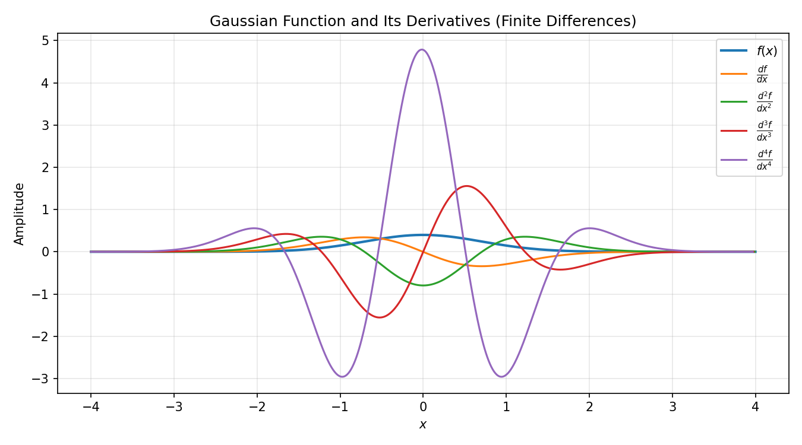
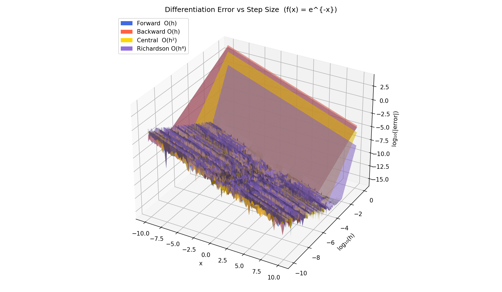
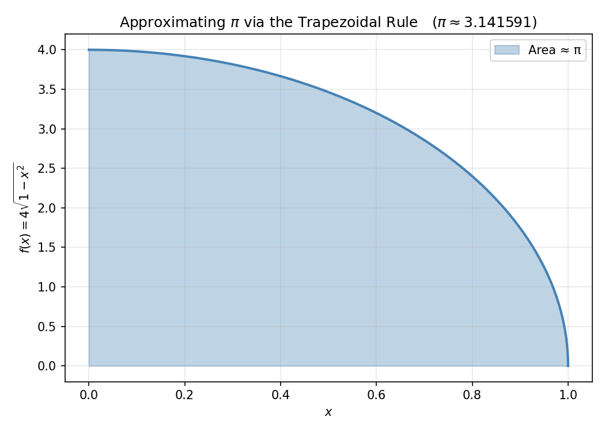
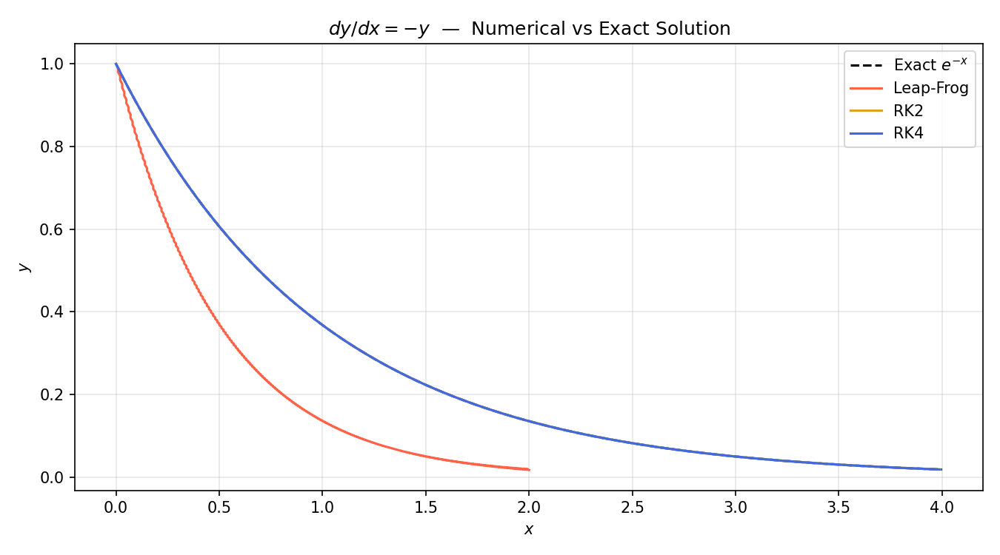
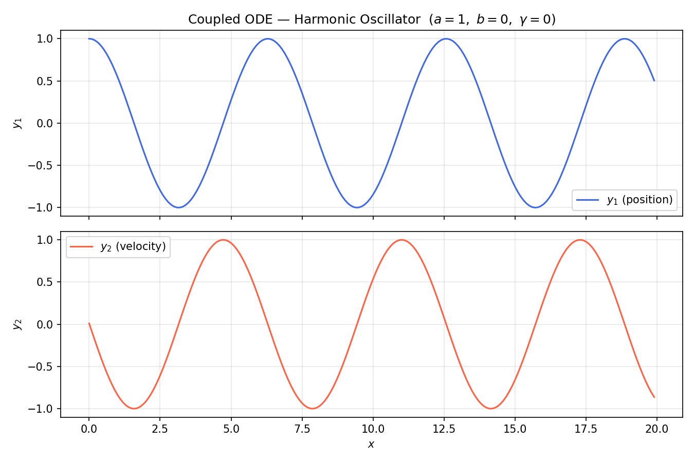

# 02 — Numerical Methods

Implementation and visualisation of core numerical analysis techniques: finite-difference differentiation, error analysis, numerical integration, and ODE solvers.

---

## Files

| File | Description | Original |
|------|-------------|----------|
| [numerical_differentiation.py](numerical_differentiation.py) | Gaussian derivatives via forward & central finite differences (orders 1–4) | `differentiation.py` |
| [differentiation_error.py](differentiation_error.py) | 3-D error surface comparing 4 differentiation schemes vs step size h | `differror.py` |
| [pi_approximation.py](pi_approximation.py) | Approximates π by integrating a quarter-circle with the trapezoidal rule | `pi.py` |
| [trapezoidal_integration.py](trapezoidal_integration.py) | Interactive trapezoidal integration of cos(x) over user-defined bounds | `trapezoid.py` |
| [ode_solvers.py](ode_solvers.py) | Leap-Frog, RK2, RK4 for a single ODE; RK4 for a coupled harmonic oscillator | `ode.py` |

All outputs are saved to [outputs/](outputs/).

---

## Running

```bash
cd 02_numerical_methods

python numerical_differentiation.py   # → outputs/numerical_differentiation.png
python differentiation_error.py       # → outputs/differentiation_error.png
python pi_approximation.py            # → outputs/pi_approximation.png
python trapezoidal_integration.py     # prompts for a, b, N → outputs/trapezoidal_integration.png
python ode_solvers.py                 # → outputs/ode_single.png, ode_coupled.png
```

---

## Theory

### Finite Difference Stencils

| Scheme | Formula | Error order |
|--------|---------|-------------|
| Forward  | `[f(x+h) − f(x)] / h` | O(h) |
| Backward | `[f(x) − f(x−h)] / h` | O(h) |
| Central  | `[f(x+h/2) − f(x−h/2)] / h` | O(h²) |
| Richardson extrapolation | `(4·C(h/2) − C(h)) / 3` | O(h⁴) |

The error analysis script sweeps both x ∈ [−10, 10] and h ∈ [10⁻¹⁰, 1] to show
how truncation error and round-off error compete as h → 0.

### Trapezoidal Rule

$$\int_a^b f(x)\,dx \approx h\sum_{i=0}^{N-1} f(x_i) - \frac{h}{2}f(a) - \frac{h}{2}f(b)$$

with uniform spacing h = (b−a)/(N−1).

### ODE Methods

**Leap-Frog** (Part 1):
```
y[i] = y[i-2] + 2h · f(x[i-1], y[i-1])
```
Second-order accurate but requires one bootstrapping Euler step.

**RK4** (Parts 1 & 2):
```
k1 = h·f(xᵢ,        yᵢ)
k2 = h·f(xᵢ+h/2,    yᵢ+k1/2)
k3 = h·f(xᵢ+h/2,    yᵢ+k2/2)
k4 = h·f(xᵢ+h,      yᵢ+k3)
yᵢ₊₁ = yᵢ + (k1 + 2k2 + 2k3 + k4) / 6
```
Fourth-order accurate; the gold standard for non-stiff ODEs.

---

## Sample Outputs

### `numerical_differentiation.py`


### `differentiation_error.py`


### `pi_approximation.py`


### `ode_solvers.py`



---

## Improvements Over Original Code

| Issue | Fix |
|-------|-----|
| `print ("Pi es: %f") %(integral)` — Python 2 style | `print("Pi es: %f" % integral)` |
| `input()` returned `str` in Python 3, causing `TypeError` in `trapezoidal` | Wrapped with `float()` / `int()` casts |
| Duplicate `plt.show()` in `differror.py` | Removed redundant call |
| No legend in error plot | Added colour-coded legend via `Patch` proxies |
| No labels on coupled-ODE axes | Added xlabel, ylabel, title, legend |
| All plots used `plt.show()` (blocked execution, no file output) | Replaced with `plt.savefig()` + `plt.close()` |
