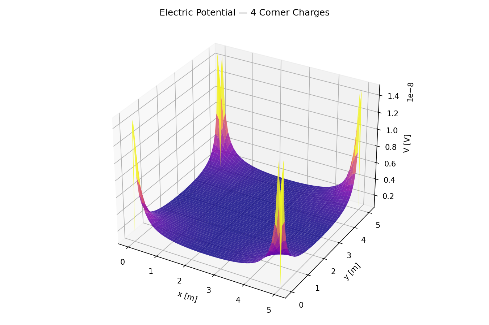
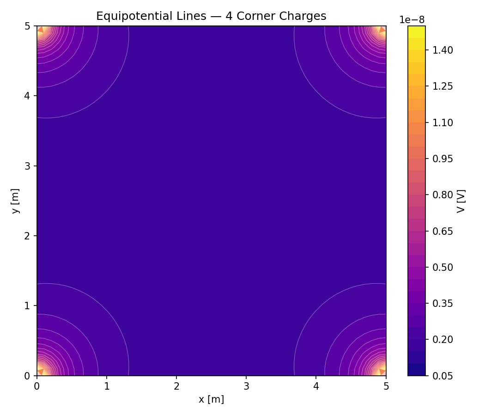
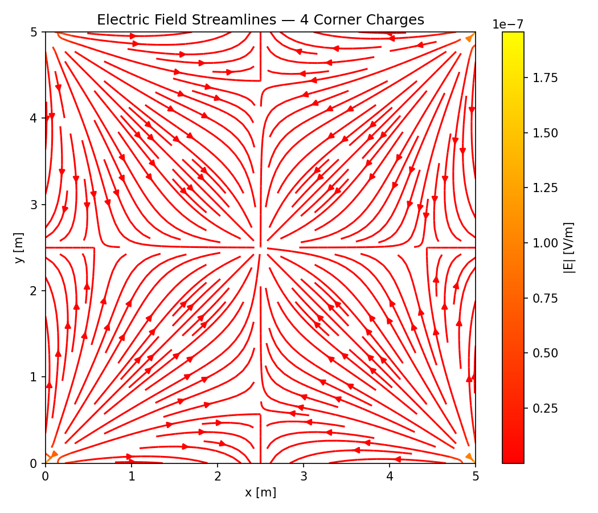
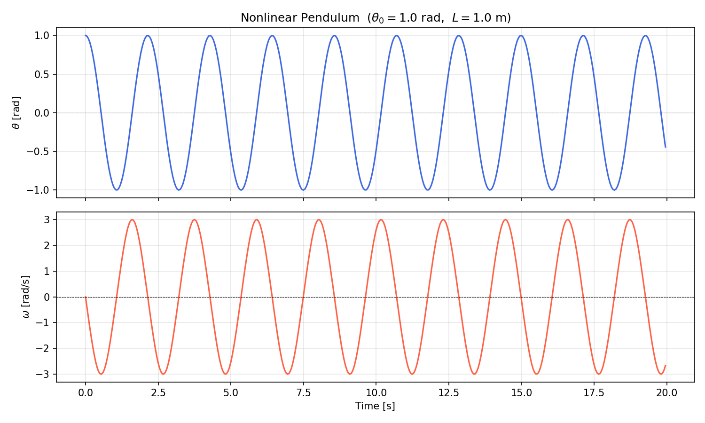
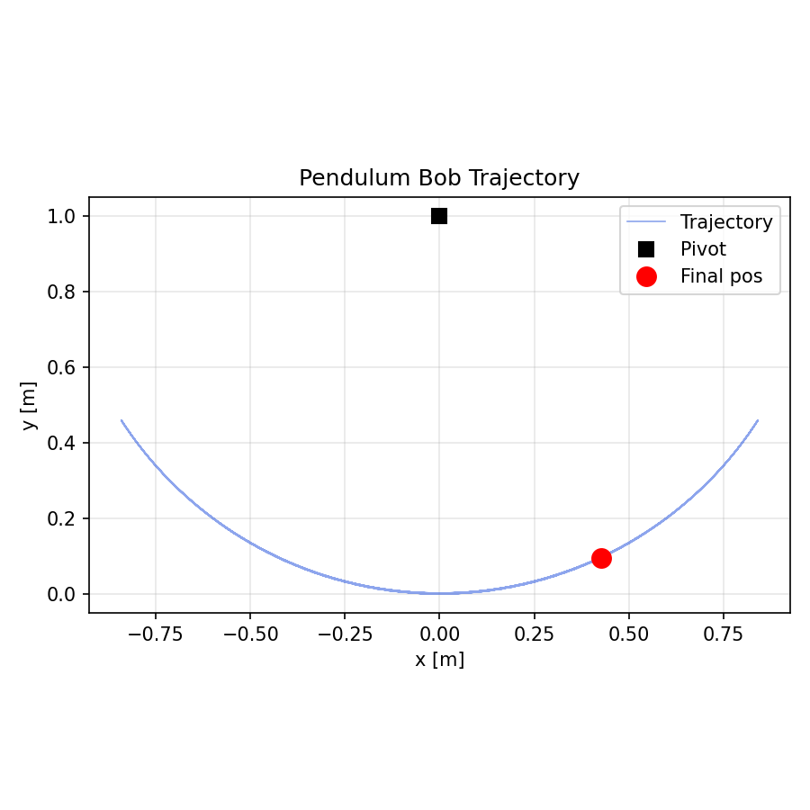

# 03 — Physics Simulations

Computational physics exercises: electrostatics, nonlinear dynamics, and geophysics data visualisation.

---

## Files

| File | Description | Original |
|------|-------------|----------|
| [electric_potential.py](electric_potential.py) | Electric potential V(x,y) and field E for 4 point charges via Coulomb's law | `cargas.py` |
| [nonlinear_pendulum.py](nonlinear_pendulum.py) | RK4 solution of the nonlinear pendulum; angle and trajectory plots | `pendulo.py` |
| [earthquake_map.py](earthquake_map.py) | Geographic scatter map of seismic epicentres from a dataset | `ejercicioClase4.py` |

All outputs are saved to [outputs/](outputs/).

---

## Running

```bash
cd 03_physics_simulations

python electric_potential.py
# → outputs/electric_potential_3d.png
# → outputs/electric_potential_contour.png
# → outputs/electric_field_streamplot.png

python nonlinear_pendulum.py
# → outputs/pendulum_solution.png
# → outputs/pendulum_trajectory.png

# earthquake_map.py needs sismos.txt in this folder
bash ../06_bash_scripts/fetch_earthquake_data.sh
mv sismos.txt 03_physics_simulations/
python earthquake_map.py
# → outputs/earthquake_map.png
```

---

## Theory

### Electric Potential (`electric_potential.py`)

The potential contribution of a point charge q at distance r is:

$$V = \frac{k_e \, q}{r}, \qquad k_e = 8.987 \times 10^9\ \text{N·m}^2/\text{C}^2$$

Four charges are superimposed by linearity. The electric field is recovered via central differences:

$$\vec{E} = -\nabla V \approx -\left(\frac{\partial V}{\partial x}\hat{x} + \frac{\partial V}{\partial y}\hat{y}\right)$$

### Nonlinear Pendulum (`nonlinear_pendulum.py`)

The exact (non-linearised) equation of motion:

$$\frac{d^2\theta}{dt^2} = -\frac{g}{L}\sin\theta$$

is cast as a coupled first-order system and integrated with RK4 (Δt = 0.05 s).
Unlike the small-angle approximation (sin θ ≈ θ), this model captures period
lengthening and energy conservation accurately for large amplitudes.

### Earthquake Map (`earthquake_map.py`)

Reads a tab-separated file of seismic event records. Columns 20 and 21 contain
latitude and longitude respectively. NaN values are masked before plotting.

---

## Sample Outputs

### `electric_potential.py`







### `nonlinear_pendulum.py`





---

## Improvements Over Original Code

| Issue | Fix |
|-------|-----|
| `e = -1.602176e-16` (wrong exponent) | Corrected to `1.602176e-19` C |
| `k = 8.987e27 / e` (compensated wrong value) | Replaced with standard `8.987e9` N·m²/C² |
| `derivar()` returned wrong variable | Refactored into clean `central_diff()` helper |
| Bare `plt.show()` calls (multiple blocking windows) | Replaced with `plt.savefig()` + `plt.close()` |
| No axis labels on streamplot | Added xlabel, ylabel, title, colourbar |
| Animation in `pendulo.py` blocked headless execution | Removed animation; saved static trajectory plot |
| No NaN guard in earthquake data | Added `np.isfinite()` mask |
