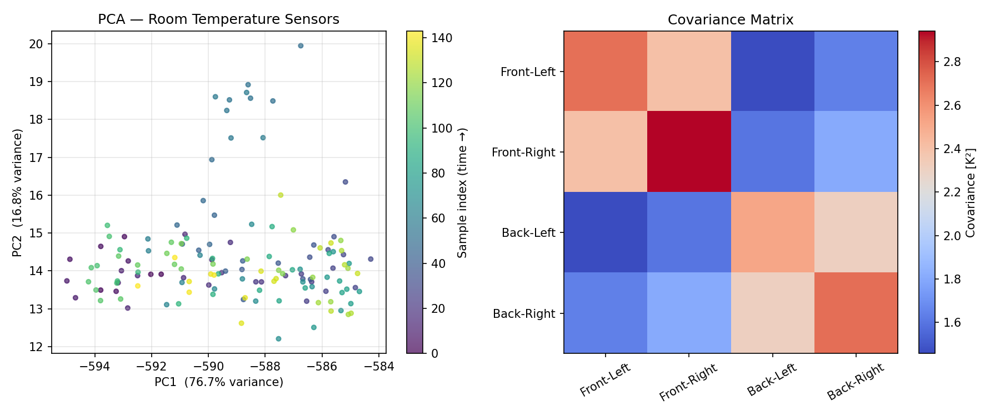
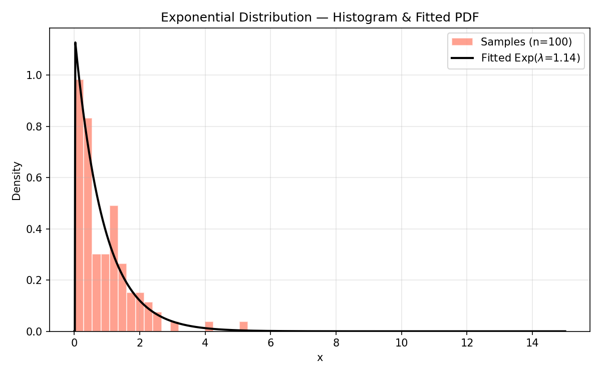
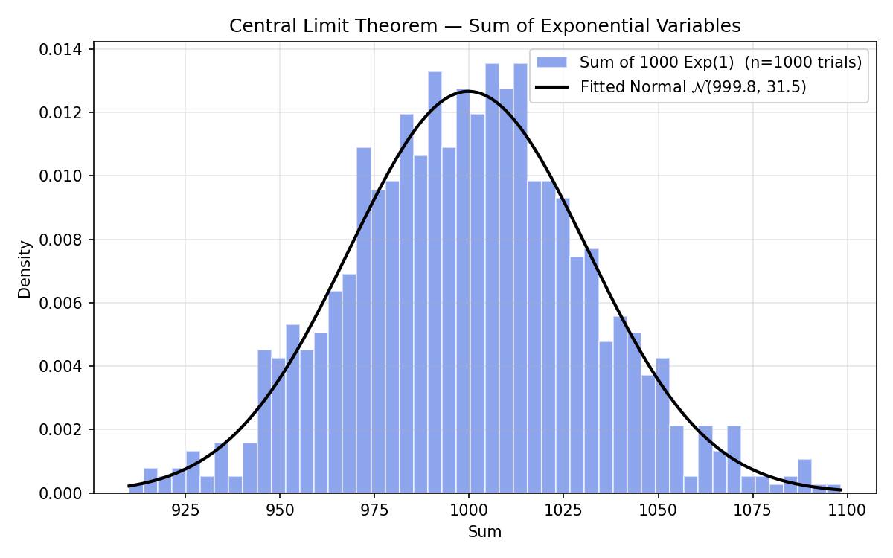

# 04 — Data Analysis

Statistical and exploratory data analysis: covariance, PCA, distributions, text analysis, and number theory.

---

## Files

| File | Description | Original |
|------|-------------|----------|
| [covariance_pca.py](covariance_pca.py) | Manual covariance matrix + PCA on 4-sensor room temperature data | `cov.py` |
| [world_bank_pca.py](world_bank_pca.py) | Normalisation, covariance, and PCA on 5 World Bank socioeconomic indicators | `PCA.py` |
| [statistical_distributions.py](statistical_distributions.py) | Exponential distribution fitting and Central Limit Theorem verification | `ejerciciolab3.py` |
| [word_frequency.py](word_frequency.py) | Word-length frequency histogram from a Project Gutenberg text | `ej2labw1.py` |
| [gcd_calculator.py](gcd_calculator.py) | Divisors, parity, and GCD of two user-supplied integers | `ejercicio.py` |

All plots saved to [outputs/](outputs/).

---

## Running

```bash
cd 04_data_analysis

# Uses ../data/roomtemperature.csv (already in the repo)
python covariance_pca.py
# → outputs/covariance_pca.png

# Requires DatosBancoMundial5.csv — place it in 04_data_analysis/
python world_bank_pca.py
# → outputs/world_bank_data_histograms.png
# → outputs/world_bank_pca_data.png
# → outputs/world_bank_pca_variables.png

# Fully self-contained
python statistical_distributions.py
# → outputs/exponential_distribution.png
# → outputs/central_limit_theorem.png

# Requires pg1524.txt — run fetch script first
bash ../06_bash_scripts/fetch_word_frequency_data.sh
mv pg1524.txt 04_data_analysis/
python word_frequency.py
# → outputs/word_frequency.png

# Interactive (prompts for two integers)
python gcd_calculator.py
```

---

## Theory

### PCA Pipeline (`covariance_pca.py`, `world_bank_pca.py`)

1. **Centre** the data: subtract column means.
2. **Compute** the covariance matrix C manually:
   $$C_{ij} = \frac{1}{n-1}\sum_{k}(x_{ik} - \bar{x}_i)(x_{jk} - \bar{x}_j)$$
3. **Eigendecompose**: C·v = λ·v  →  sort by descending λ.
4. **Project**: `projected = V^T · X` where V = matrix of eigenvectors.

### Central Limit Theorem (`statistical_distributions.py`)

For i.i.d. Exp(1) variables X₁, …, Xₙ:
$$S_n = \sum_{i=1}^n X_i \xrightarrow{d} \mathcal{N}(n,\, n) \quad \text{as } n \to \infty$$

The script verifies this empirically with n = 1000, repeated 1000 times.

### GCD Algorithm (`gcd_calculator.py`)

Finds GCD by computing all divisors of both numbers and taking the maximum
common element. Verified against Python's built-in `math.gcd()`.

---

## Sample Outputs

### `covariance_pca.py`


### `statistical_distributions.py`



---

## Improvements Over Original Code

| Issue | Fix |
|-------|-----|
| `normed=True` (deprecated in NumPy ≥ 1.11) | Changed to `density=True` |
| `np.random.exponential()` with no seed (non-reproducible) | Added `np.random.default_rng(seed=42)` |
| Output saved as PDF, not embeddable in README | Changed to PNG |
| `input()` in Python 2 style (evaluates expression) | Wrapped with `int()` cast |
| No guard for missing data files | Added `os.path.exists()` check + helpful message |
| GCD loop used redundant `number += 1` inside `for` loop | Replaced with clean list comprehension |
