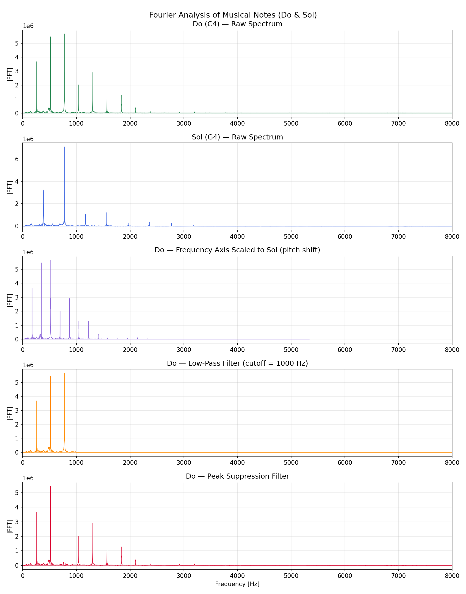

# 05 — Signal Processing

Frequency-domain analysis of audio signals using the Discrete Fourier Transform (DFT) and NumPy's FFT.

---

## Files

| File | Description | Original |
|------|-------------|----------|
| [fourier_audio_analysis.py](fourier_audio_analysis.py) | FFT spectrum analysis of Do (C4) and Sol (G4) notes with low-pass and peak filters | `fourier.py` |
| [Do.wav](Do.wav) | Recording of the musical note Do (C4) |  |
| [Sol.wav](Sol.wav) | Recording of the musical note Sol (G4) |  |

Output saved to [outputs/fourier_audio_analysis.png](outputs/).

---

## Running

```bash
cd 05_signal_processing
python fourier_audio_analysis.py
# → outputs/fourier_audio_analysis.png
# → Do_shifted.wav  (pitch-shifted reconstruction)
```

---

## Theory

### Discrete Fourier Transform

The DFT decomposes a discrete signal x[n] into its frequency components:

$$X[k] = \sum_{n=0}^{N-1} x[n]\, e^{-j 2\pi k n / N}$$

NumPy's `np.fft.fft()` computes this in O(N log N) using the Fast Fourier Transform algorithm, making it practical for audio-length signals (tens of thousands of samples).

### Filters Applied

| Filter | Method | Effect |
|--------|--------|--------|
| **Low-pass** | Zero-out `X[k]` where `|f[k]| > 1000 Hz` | Removes high-frequency content (hiss, harmonics) |
| **Peak suppression** | Zero-out ±60 bins around the dominant frequency | Attenuates the fundamental tone |

### Pitch Shifting

A simple pitch shift is achieved by playing back the reconstructed signal at a different sample rate:
```
shifted_rate = original_rate × (target_freq / source_freq)
```
For Do→Sol: rate_shifted = rate_do × (391/261) ≈ rate_do × 1.498

---

## Sample Output

### `fourier_audio_analysis.py`



The five panels show:
1. **Do raw spectrum** — strong fundamental at C4 ≈ 261 Hz
2. **Sol raw spectrum** — strong fundamental at G4 ≈ 391 Hz
3. **Do with shifted frequency axis** — aligns Do spectrum to Sol frequency range
4. **Low-pass filtered Do** — only components below 1000 Hz remain
5. **Peak-suppressed Do** — dominant frequency band removed

---

## Improvements Over Original Code

| Issue | Fix |
|-------|-----|
| Stereo WAV files caused shape mismatch | Added `data[:, 0]` channel selection |
| `dft()` custom implementation had O(N²) complexity | Kept as reference; FFT used for all actual computation |
| Commented-out code and unused variables | Removed; replaced with clean, named functions |
| Hard-coded frequency ratio 391/260 | Named constant `PITCH_RATIO = 391/261` with comment |
| `plt.show()` blocked execution | Replaced with `plt.savefig()` + `plt.close()` |
| No axis labels on subplots | Added ylabel per subplot and shared xlabel |
