# Computational Methods — Course Repository

A structured collection of exercises and implementations covering numerical analysis, physics simulations, data analysis, signal processing, and systems programming.
Course: **Métodos Computacionales** — Universidad de los Andes.

---

## Repository Structure

```
MetodosComputacionales/
├── 01_python_fundamentals/     Python basics: lists, dicts, loops, OOP
├── 02_numerical_methods/       Differentiation, integration, ODE solvers
├── 03_physics_simulations/     Electrostatics, pendulum dynamics, seismology
├── 04_data_analysis/           Covariance, PCA, distributions, text analysis
├── 05_signal_processing/       Fourier transform, audio filtering
├── 06_bash_scripts/            Data acquisition and automation scripts
├── 07_c_programming/           Memory management, arrays, file I/O in C
└── data/                       Shared datasets (room temperature CSV)
```

---

## Modules

### [01 — Python Fundamentals](01_python_fundamentals/README.md)

| File | Topic |
|------|-------|
| `lists_and_operators.py` | Lists, indexing, arithmetic operators, string formatting |
| `dicts_and_control_flow.py` | Dictionaries, conditionals, for/while loops, break/continue |
| `file_io_and_parsing.py` | Reading text files, rstrip, split |
| `numpy_and_functions.py` | NumPy arrays, BMI, unit conversion, functions |
| `classes_and_oop.py` | Class definition, constructor, instance methods |
| `greeter.py` | Minimal function-with-arguments demo |

---

### [02 — Numerical Methods](02_numerical_methods/README.md)

| File | Topic |
|------|-------|
| `numerical_differentiation.py` | Forward & central differences on Gaussian, orders 1-4 |
| `differentiation_error.py` | 3-D error surface: 4 schemes vs step size h |
| `pi_approximation.py` | pi via trapezoidal integration of a quarter-circle |
| `trapezoidal_integration.py` | Interactive integration of cos(x) |
| `ode_solvers.py` | Leap-Frog, RK2, RK4; coupled harmonic oscillator |

**Sample outputs:**

| | |
|---|---|
| 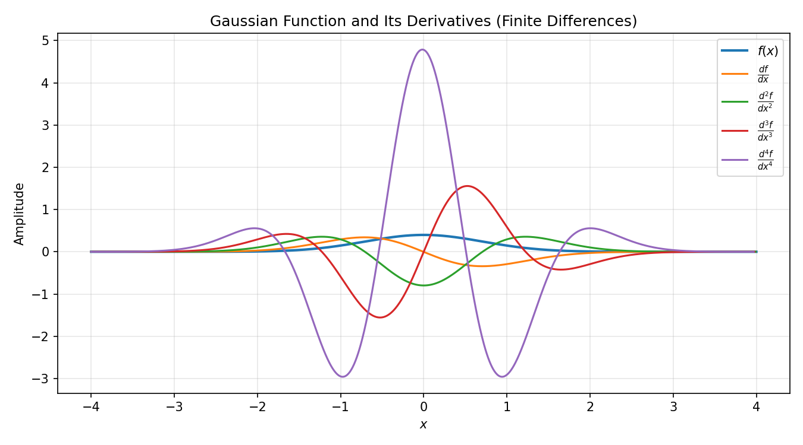 | 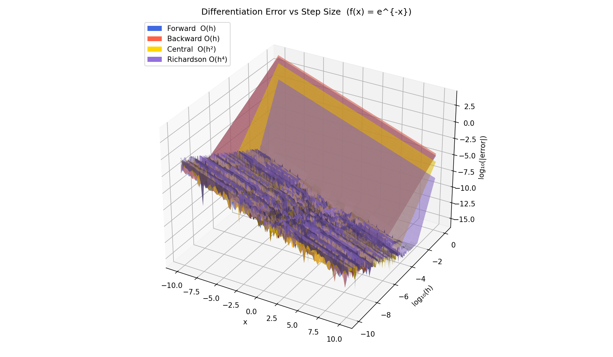 |
| 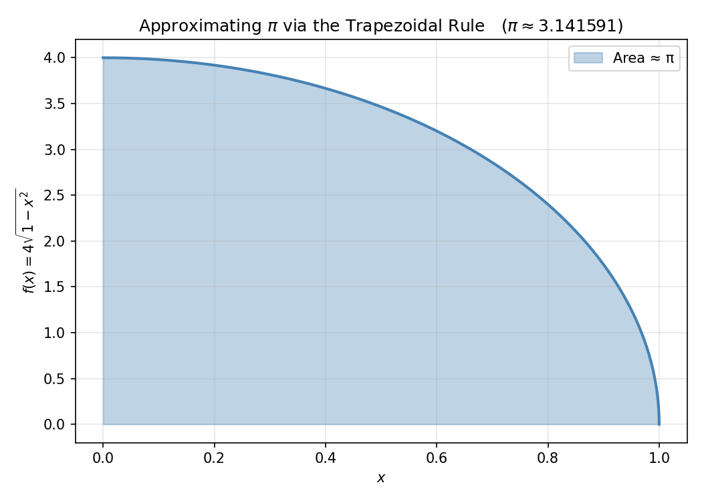 | 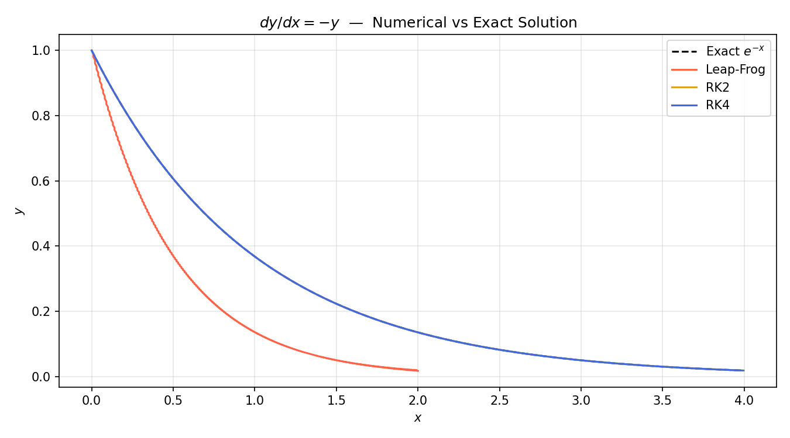 |

---

### [03 — Physics Simulations](03_physics_simulations/README.md)

| File | Topic |
|------|-------|
| `electric_potential.py` | Coulomb potential + E-field streamlines for 4 charges |
| `nonlinear_pendulum.py` | RK4 solution of d2theta/dt2 = -sin(theta) |
| `earthquake_map.py` | Geographic scatter map of seismic epicentres |

**Sample outputs:**

| | |
|---|---|
| 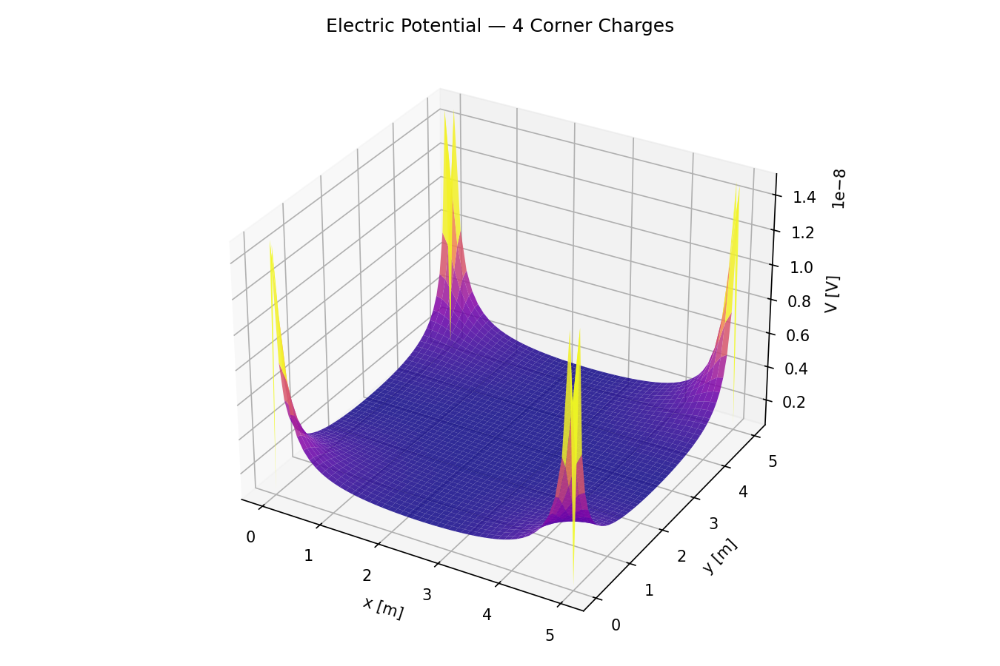 | 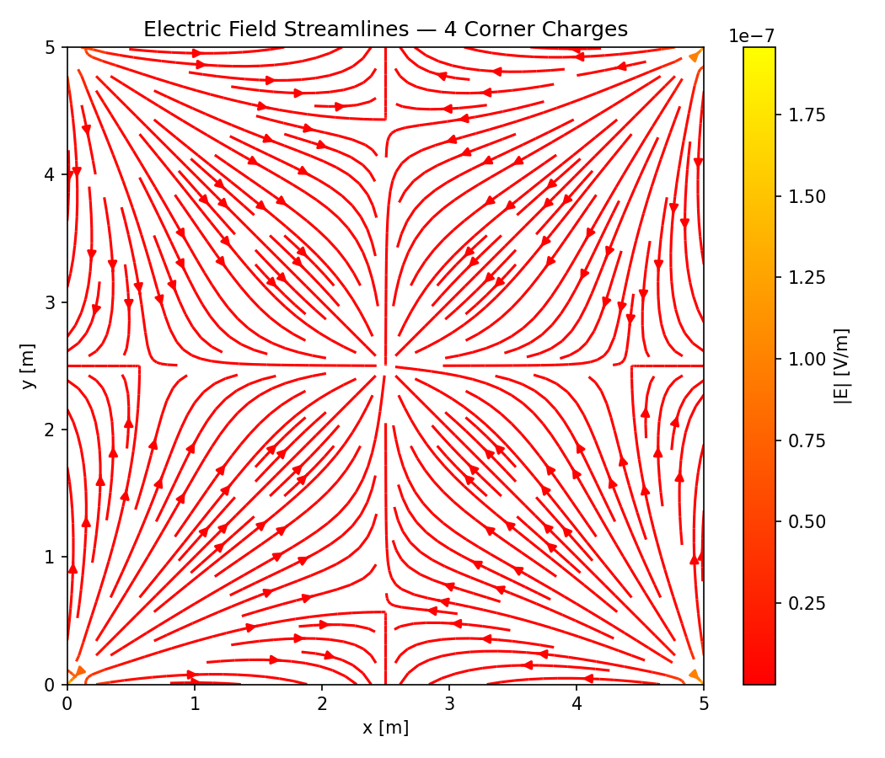 |
| 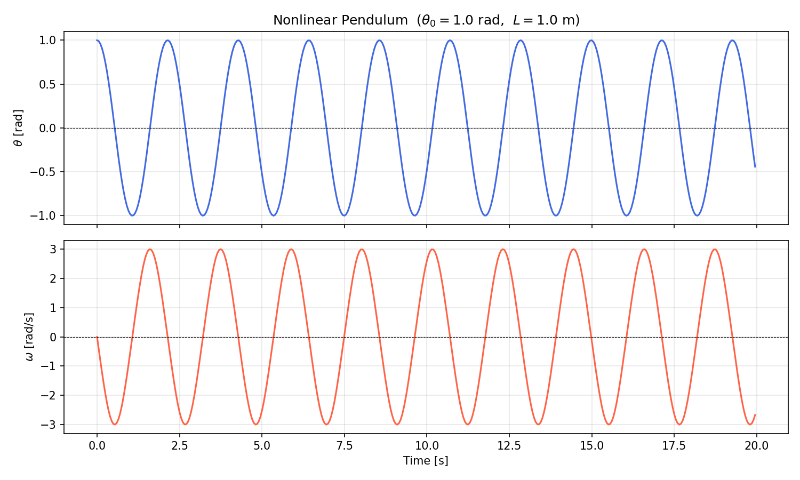 | 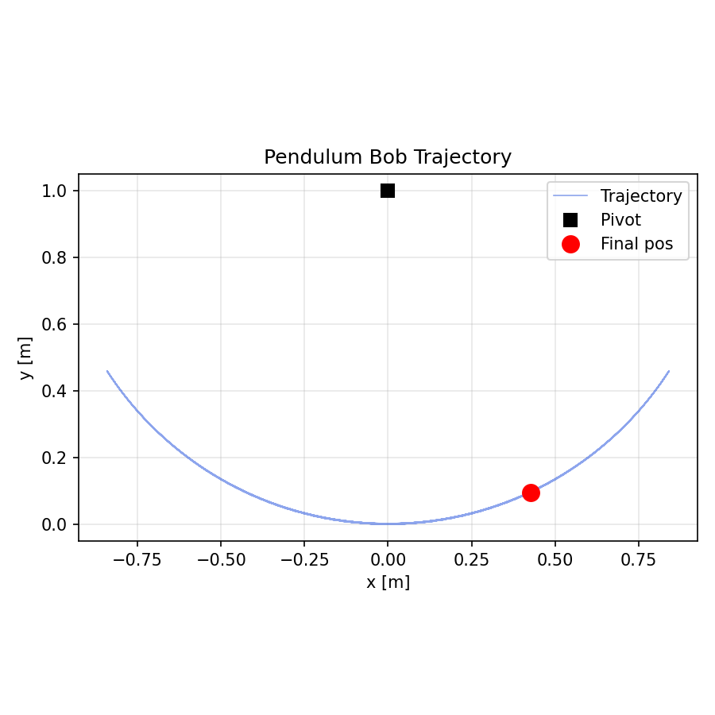 |

---

### [04 — Data Analysis](04_data_analysis/README.md)

| File | Topic |
|------|-------|
| `covariance_pca.py` | Manual covariance matrix + PCA on 4 temperature sensors |
| `world_bank_pca.py` | Normalisation + PCA on 5 World Bank indicators (needs CSV) |
| `statistical_distributions.py` | Exponential fit + Central Limit Theorem demo |
| `word_frequency.py` | Word-length histogram from Project Gutenberg text |
| `gcd_calculator.py` | Divisors, parity, GCD via user input |

**Sample outputs:**

| | |
|---|---|
| 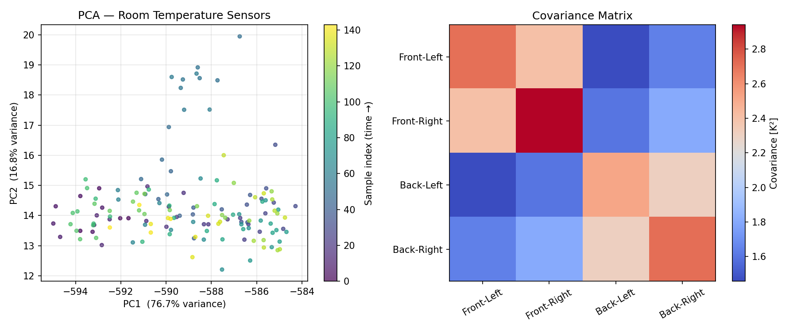 | 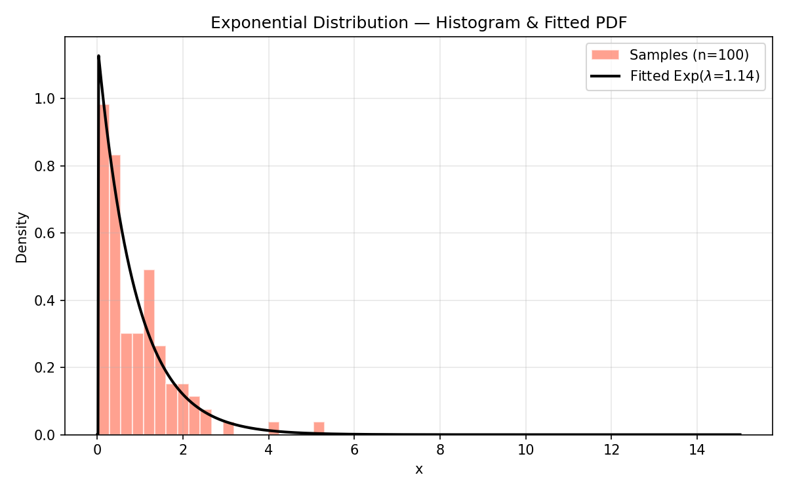 |
| 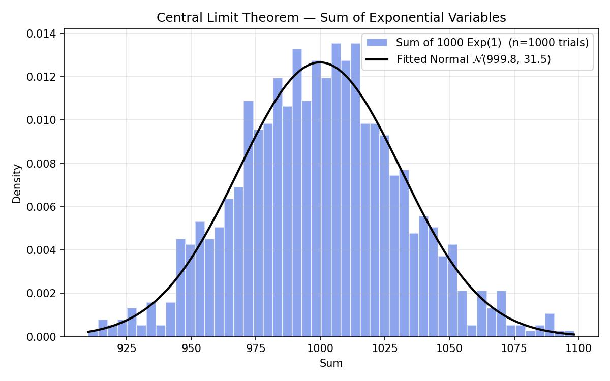 | |

---

### [05 — Signal Processing](05_signal_processing/README.md)

| File | Topic |
|------|-------|
| `fourier_audio_analysis.py` | FFT of Do (C4) + Sol (G4) WAV files; low-pass and peak filters |

**Sample output:**

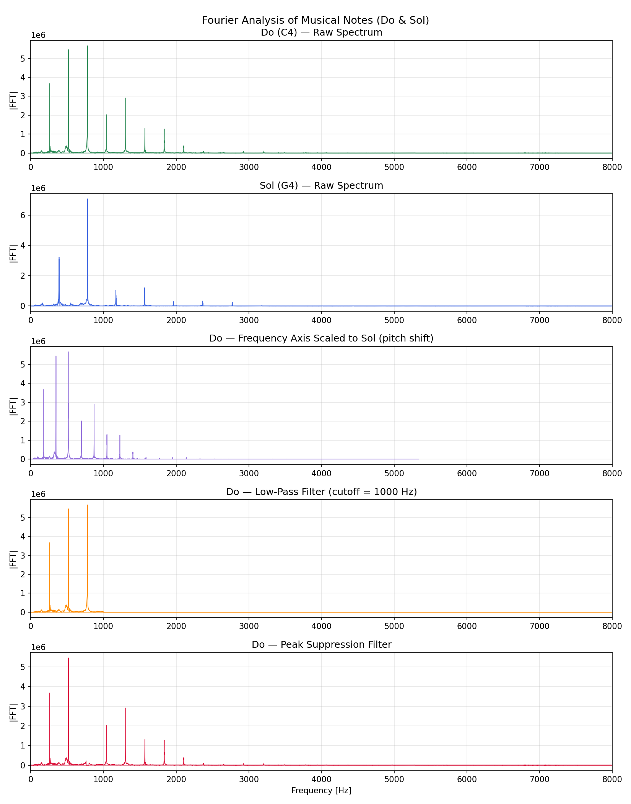

---

### [06 — Bash Scripts](06_bash_scripts/README.md)

| Script | Action |
|--------|--------|
| `fetch_word_frequency_data.sh` | Download Gutenberg text, run word-frequency analysis |
| `fetch_contact_data.sh` | Download contact file, run file I/O exercise |
| `fetch_earthquake_data.sh` | Download sismos.txt, run earthquake map |
| `engineering_pass_rate.sh` | Count ING students with average >= 3.0 using AWK |
| `math_pass_rate.sh` | Count MATEMA students with average >= 3.0 using AWK |

---

### [07 — C Programming](07_c_programming/README.md)

| File | Topic |
|------|-------|
| `c_fundamentals.c` | linspace, file I/O, geometry, static/dynamic arrays, control flow |

```bash
cc 07_c_programming/c_fundamentals.c -lm -o c_fundamentals && ./c_fundamentals
```

---

## Technology Stack

| Language | Libraries | Purpose |
|----------|-----------|---------|
| Python 3 | NumPy, Matplotlib, SciPy, Pandas | All numerical and data work |
| Bash | wget, awk, wc | Data acquisition and automation |
| C | stdlib, math | Low-level systems programming |

---

## Quick Start

```bash
# Install Python dependencies
pip install numpy matplotlib scipy pandas

# Run any module (example)
python 02_numerical_methods/ode_solvers.py

# All figures are saved to each module's outputs/ folder
```

---

## Data Files

| File | Used by | Source |
|------|---------|--------|
| `data/roomtemperature.csv` | `04_data_analysis/covariance_pca.py` | Bundled in repo |
| `05_signal_processing/Do.wav` | `05_signal_processing/fourier_audio_analysis.py` | Bundled in repo |
| `05_signal_processing/Sol.wav` | `05_signal_processing/fourier_audio_analysis.py` | Bundled in repo |
| `sismos.txt` | `03_physics_simulations/earthquake_map.py` | Downloaded by `fetch_earthquake_data.sh` |
| `pg1524.txt` | `04_data_analysis/word_frequency.py` | Downloaded by `fetch_word_frequency_data.sh` |
| `DatosBancoMundial5.csv` | `04_data_analysis/world_bank_pca.py` | Provided separately |
